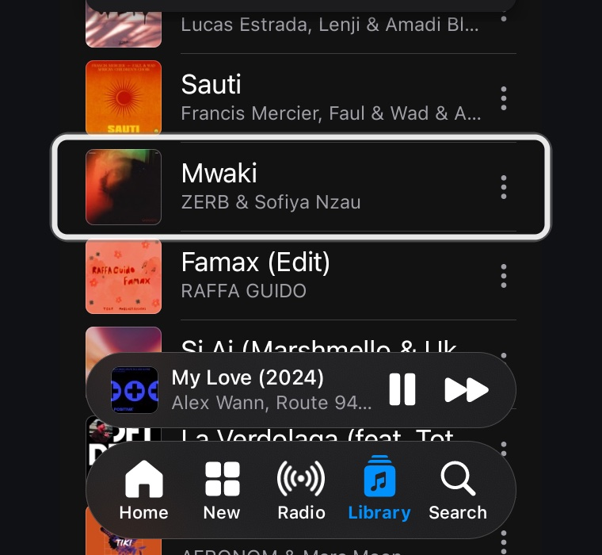
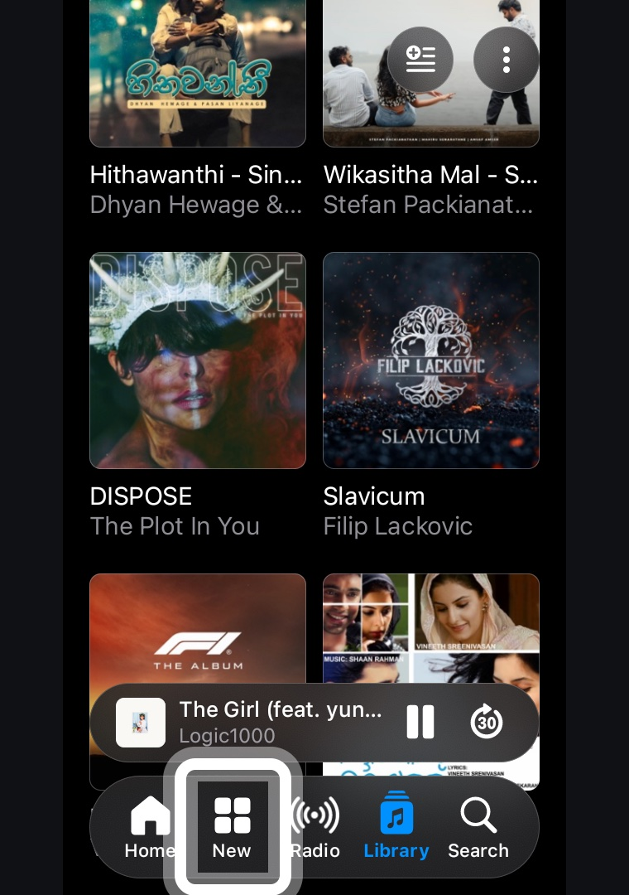
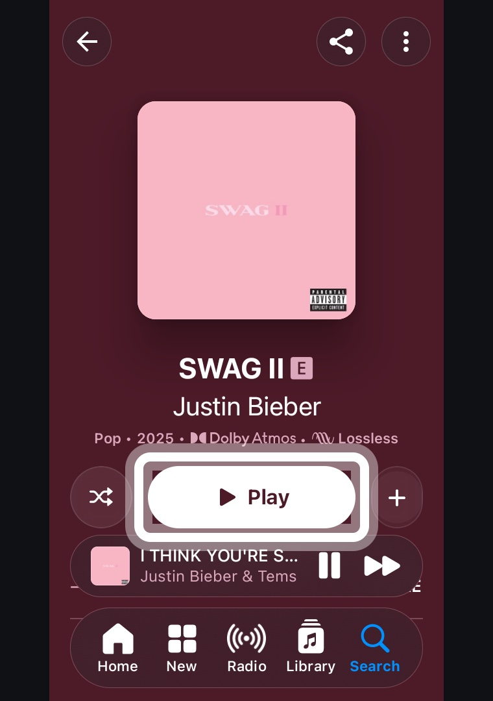
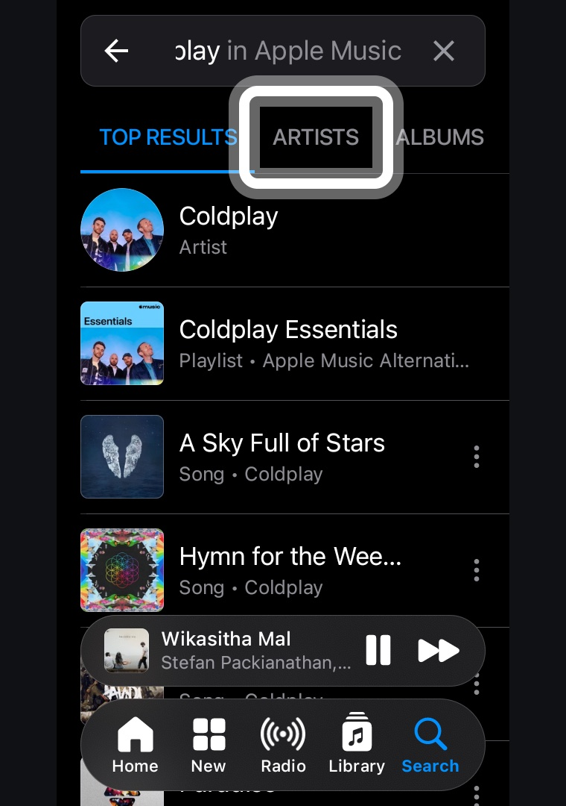
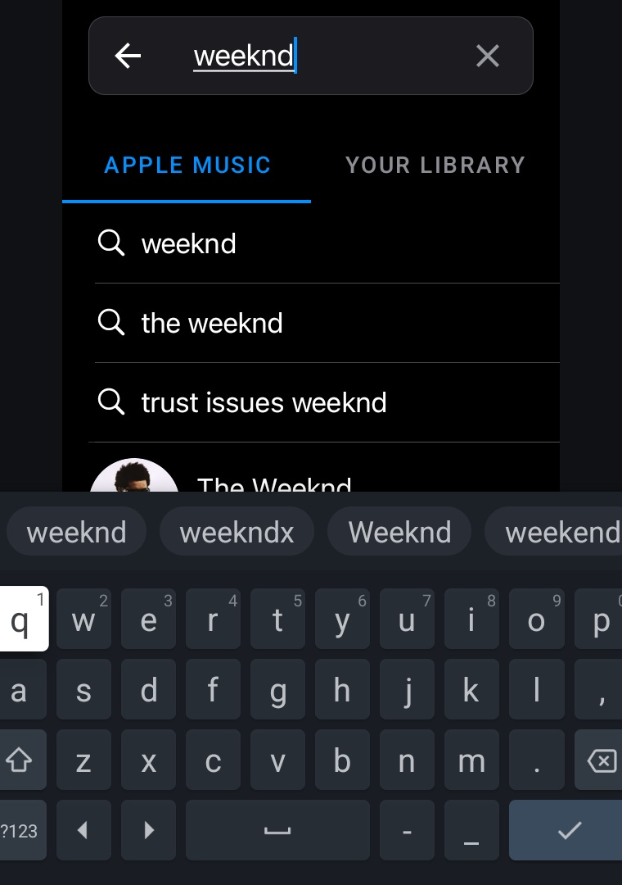

# Focus Highlighter for Apple Music on Android TV

Apple doesn't make Apple Music for Android TV / Google TV. The phone app can be
sideloaded and plays fine (including Lossless and Dolby Atmos over HDMI/eARC),
but it was built for touch: with a TV remote the focus jumps unpredictably and
you often can't tell what is selected.

Focus Highlighter is a small accessibility service that makes the phone app
usable with only a D-pad remote. It is active only while Apple Music is in the
foreground and does nothing in other apps.

## Screenshots

| Songs | Albums | Album | Search |
|---|---|---|---|
|  |  |  |  |

Typing a search with the remote — the keyboard's Enter key submits it:



## Features

- **Clear selection outline** — a white rounded box with a soft grey rim around
  the selected item (dashed when the item is partly behind the mini-player or
  tab bar).
- **Its own spatial navigation** — Up/Down/Left/Right move between individual
  tiles, rows, buttons and tabs instead of relying on Apple's erratic D-pad focus.
  Lists and shelves scroll automatically when you reach the edge.
- **OK** clicks the selected item.
- **Hold Back** (≥ 0.5 s) jumps to the tab bar (Home / New / Radio / Library / Search).
- **Search** — OK on the search bar enters search mode and opens the keyboard;
  the keyboard's Enter key submits the search.
- **Full-screen player** — Left/Right = previous/next track, OK = play/pause,
  Up = reach the top-row buttons.
- **Home screen tile** — an "Apple Music" banner in the TV launcher that opens
  the app.

Collects no data and has no network access.

## Requirements

- Android TV / Google TV, Android 11 (API 30) or newer.
- Apple Music for Android installed on the TV (not included here). On TVs where
  the Play Store says it's incompatible, install the official app bundle with
  `adb install-multiple` (base APK + the ABI and density splits for your TV).
- adb access to the TV (Developer options → USB/network debugging).

Tested on a 2023 TCL Smart TV Pro (Google TV, Android 14, 1080p UI) with Apple
Music 7.0.0. Apple Music updates can change its layout, so some tuning may be
needed for other versions or devices.

## Build

No Gradle — just the Android SDK command-line tools and JDK 17:

```bash
# defaults are Homebrew paths; override if yours differ
export JAVA_HOME=/path/to/jdk17
export ANDROID_SDK=/path/to/android-sdk   # needs build-tools 34.0.0 and platforms/android-34
./build.sh
```

This produces `focus-highlighter.apk`. The first build creates a local signing
key (`focushl.keystore`); keep it, because updates must be signed with the same key.

## Install

```bash
adb connect <tv-ip>:5555
adb install -r focus-highlighter.apk
```

Then on the TV: **Settings → System → Accessibility → Focus Highlighter → Enable**.

**TCL TVs:** TCL's auto-start manager blocks sideloaded accessibility services
from starting. Allow it first, then toggle the service off and on:

```bash
adb shell appops set com.osura.focushl AUTO_START allow
```

## Testing

Simulated `adb shell input keyevent` presses don't reach an accessibility key
filter, so the service has a test hook (a broadcast receiver protected by the
`DUMP` permission, which only adb/shell holds):

```bash
TV=<tv-ip>:5555 ./test.sh key down down right ok   # drive it like a remote
TV=<tv-ip>:5555 ./test.sh state                    # what's selected
TV=<tv-ip>:5555 ./test.sh shot screen.png          # screenshot
```

## Alternatives

- [AMTV](https://github.com/megarohas/apple-music-android-tv) — a separate,
  remote-first TV app built on Apple's web player. Nicer TV-style interface, but
  the web player streams standard AAC (no Lossless or Dolby Atmos). Focus
  Highlighter keeps the official app, so Lossless and Atmos still work.

## Notes

- Most TVs have no touchscreen, so accessibility gestures (taps/swipes) are
  always cancelled; everything is done with accessibility actions instead.
- This project doesn't modify Apple Music and isn't affiliated with or endorsed
  by Apple. Apple Music is a trademark of Apple Inc.

## License

MIT — see [LICENSE](LICENSE).
